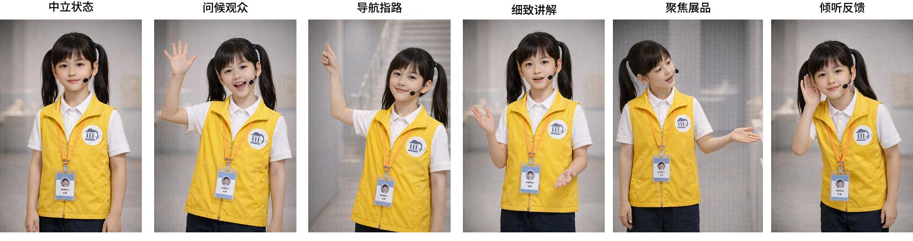
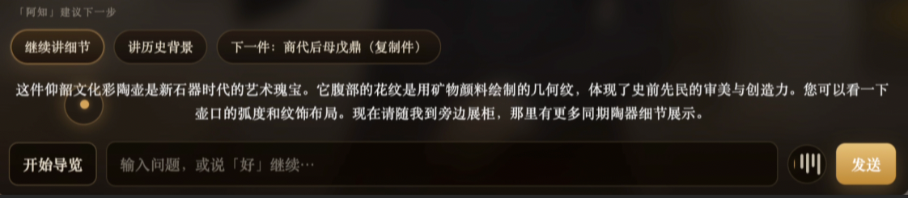

<p align="center">
  
</p>

# MuseGuide - 面向博物馆学习场景的对话式具身数字人导览

<a id="zh"></a>
<p align="center">中文 | <a href="#en">English</a></p>


<p align="center">
  <strong>Conversation × Context × Embodied Guidance</strong><br/>
</p>


<p align="center">
  
  
  
  
</p>

<p align="center">
  
</p>

---

## ✨🎯 Overview

MuseGuide 是一个面向博物馆学习场景的对话式具身导览系统原型。🏛️✨

## ✨🚀🧭 系统特点


### 1) 👥🎭✨ 多人物、多性格导览
> 角色即体验

> 
> 只有一个“标准播报员”，不同用户得到几乎同一语气。
>
> 
> 支持多角色、多风格（成人/儿童/古风/英文等），同一内容可用不同表达策略讲述。

我们的角色系统不仅是头像变化，还包含语言风格、导览语气、互动节奏和推荐话术差异，能够覆盖家庭观众、国际访客、文化爱好者等不同人群，降低理解门槛并提升情感连接，通过不同的人格线索和表达风格，提升观众对导览的接受度、亲近感和匹配感。


> 导览员人物形象设定表

| 名字 | 形象特征 | 性格特征 | 语言特征 | 行为特征 | 适配观众 |
| --- | --- | --- | --- | --- | --- |
| 阿知 | 现代职业导览员，西装形象，亲和得体 | 温和稳妥，注重细节 | 中文短句，清晰有层次，不过度客套 | 细致讲解，善于引导观众观察展品细节 | 普通成人观众 |
| 阿简 | 现代职业导览员，西装形象，理性干练 | 沉稳简洁，逻辑性强 | 中文表达简明，强调“结论-要点-提醒” | 结构化讲解，指引明确，聚焦重点清晰 | 普通成人观众 |
| Emma | 国际化导览员，着导览背心，形象友好专业 | 自然友善，表达利落 | 英文讲解，自然简洁，便于理解 | 问候自然，讲解清楚，路线提示友好 | 国际观众 |
| Alex | 国际化导览员，着导览背心，形象整洁专业 | 冷静自信，条理清楚 | 英文讲解，简洁且结构化 | 强调参观路径与重点，导览节奏清晰 | 国际观众 |
| 云婉 | 古风女性形象，汉服装束，气质清雅 | 温婉含蓄，富有诗意 | 中文古雅但易懂，表达凝练婉转 | 娓娓道来，重视意境营造与柔和引导 | 传统文化兴趣观众 |
| 子叙 | 古风男性形象，汉服装束，气质沉稳 | 清朗内敛，善于点题 | 中文古雅含蓄，讲究引子与收束 | 讲解克制有序，带有仪式感与历史感 | 传统文化兴趣观众 |
| 佳佳 | 儿童导览员形象，色彩明快，亲近感强 | 轻快温柔，耐心自然 | 中文简短明了，常用小比喻帮助理解 | 以轻松方式带领观察，增强参与感 | 儿童与家庭观众 |
| 明明 | 儿童导览员形象，活泼阳光，像同伴 | 活泼好奇，直接自然 | 中文简短清楚，常用“你看”“像不像” | 以伙伴式口吻带领探索与发现 | 儿童与家庭观众 |

### 2) 🕺🧍🎬 多导览状态与动作映射
> 注意力引导和交互衔接

> 
> 回答文本和人物动作脱节，常出现“说在讲解，动作却在待机”。
>
> 
> 引路、展厅概览、展品介绍、展品聚焦、深入讲解等状态与动作强映射。

设计丰富的导览状态，并且设计了导览状态手势和眼神，支持导览中的注意力引导和交互衔接。



> 导览动作状态设计（以导览员“佳佳”为例）

| 动作状态 | 动作特征（手势 / 视线 / 表情） | 导览作用 | 个性化表现 |
| --- | --- | --- | --- |
| 中立状态 | 双手自然放置于身前，视线平视观众，表情平和放松 | 维持稳定在场感，作为状态切换前的基础姿态 | 呈现自然、亲近的陪伴气质，形成轻松开场氛围 |
| 问候观众 | 单手抬起挥手，视线主动朝向观众，表情明亮、带微笑 | 建立初始交流关系，吸引观众注意并形成互动入口 | 通过更活泼的动作与笑意，强化欢迎感与陪伴感 |
| 导航指路 | 手臂上抬并指向目标方向，头部与视线同步偏向前方路径，表情积极明确 | 提示前进方向，帮助观众形成空间跟随 | 动作轻快直接，形成“带领前往”的伴随式路径引导 |
| 细致讲解 | 双手在身前展开或轻度配合说明，视线在观众与展品之间自然切换，表情专注温和 | 支持内容展开与重点解释，维持讲解节奏 | 手势柔和、语境感更强，体现耐心细致的说明风格 |
| 聚焦展品 | 单手展开指向展品或局部区域，头部和视线明显朝向对象，表情带提示性与鼓励性 | 将观众注意力集中到当前对象或关键细节 | 通过更明确的指向与鼓励性神情，增强观察邀请感与互动引导感 |
| 倾听反馈 | 身体微微前倾，一手靠近耳侧，视线回到观众，表情柔和专注 | 表示等待回应与接收反馈，支持低负担互动接续 | 倾听动作更开放，传达愿意继续交流的亲和姿态，降低互动压力 |

### 3) 🗂️📈✅ 导览进程
> 导览员对你看过什么心中有数

> 
> 每轮像新对话，容易重复讲已看内容。
>
> 
> 会话级维护当前展区、当前展品、已看/未看展品与展区进度。

我们的会话状态会持续记录导览阶段、参观轨迹和展品进度并在每轮更新，从而避免重复推荐、减少“回到起点”的跳变，显著提升导览连续性，让导览员具备推动导览的基础。


### 4) 🧭🔀🧠 情境驱动导览策略
> 会主动推进，不等你逐条下指令

> 
> 只被动回答当前问题，回答完就停。
>
> 
> 根据“跨展厅/厅内移动、当前阶段、剩余展品”动态选择下一步策略。

我们的导览策略会区分跨展厅移动与展厅内移动，并结合当前阶段和剩余内容自动调整引导方式，导览推进更自然、用户反复下指令的成本更低，整体体验更像“导览员在主动导览”而不是“用户在手动驱动流程或者单轮问答”。

> 导览阶段（系统内置 5 阶段）

| 阶段 | 适用场景 |
| --- | --- |
| 引路阶段 | 跨展厅或厅内移动时的路径引导 |
| 展厅介绍 | 进入展厅后先给整体主题与看点概览 |
| 展品介绍 | 开始介绍某件展品的基础信息 |
| 展品聚焦 | 把注意力引导到当前展品关键细节 |
| 深入讲解 | 围绕当前展品展开背景、工艺与故事 |

**推荐推进路径：** `引路阶段 → 展厅介绍 → 展品介绍 → 展品聚焦 → 深入讲解`


### 5) 💬🧩⚡ 导览建议 + Chips
> 低成本交互，高流畅推进

> 
> 用户需要自己组织下一句指令，交互负担大。
>
> 
> 每轮返回结构化建议并渲染为 chips，可点击执行，也支持“好/继续”确认推进。

我们的 chips 建议不是静态按钮，而是基于当前导览状态与剩余内容动态生成，既支持点击执行也支持低成本确认推进，能明显降低输入负担、提升互动频率和导览完成率，实现“看得懂、点一下就到下一步”的高流畅交互。


### 6) 🔁🧩🎯 连续交互 & 意图承接
> 说“好”也能精准执行

> 
> 用户说“好”时系统常语义不明，容易接错。
>
> 
> 保持多轮交互的记忆，并在确认场景下执行建议动作，形成“建议-确认-执行”闭环。

导览员能够根据情境推荐待执行动作，并理解“好/继续”这类确认语句，形成“建议-确认-执行”的一致闭环，使自动推进逻辑可验证、可观测、可控制，用户也能明确感知导览员听懂自己的意图并且流畅执行。



<br/>

---

## 🚀 Quick Start（系统部署）

### Requirements

- Python 3.10+
- Node.js 18+

### Install

```bash
pip install fastapi uvicorn websockets pyyaml python-docx volcengine-sdk
cd frontend
npm install
```

### Configure

在 `museguide/configs/secrets.yaml` 中配置密钥：

- `doubao.api_key`
- `tts.*`
- `asr.*`

### Run Backend

```bash
./dev.sh
```

该脚本会同时启动：

- ASR WebSocket：`9001`
- TTS Worker：`8765`
- API Server：`8000`

### Run Frontend

```bash
cd frontend
npm run dev
```

## 🏗️ Backend Pipeline

当前后端导览链路大致如下：

1. 用户输入进入 `LLMOrchestrator`
2. 后端读取会话级导览状态（展厅、展品、已看/未看、阶段、待确认推荐动作）
3. `prompt_builder` 组装导览情境 prompt
4. LLM 输出结构化 JSON
5. `response_parser` 做 JSON 容错与字段归一化
6. `tour_state_manager` 更新导览进程
7. `initiative` 生成下一步推荐入口
8. 后端根据导览阶段与事件强映射视频动作状态

对应核心模块：

- `museguide/llm/orchestrator.py`
- `museguide/llm/prompt_builder.py`
- `museguide/llm/response_parser.py`
- `museguide/llm/tour_state_manager.py`
- `museguide/llm/initiative.py`
- `museguide/llm/context_store.py`

## 🧪 Current Scope

- 当前版本聚焦“博物馆导览”核心场景
- 强调原型验证与体验验证，不追求工程化完备
- 数字人表现以状态驱动为主，实时逐帧口型仍在后续方向中

## 🗺️ Roadmap

- [ ] 实时口型与视频驱动链路升级
- [ ] 更细粒度的导览情境建模
- [ ] 更系统的量化评估与对照实验
- [ ] 多语言导览体验优化

## 🤝 Contributing

欢迎 Issue / PR / 讨论建议。
如果你有博物馆教育、交互设计、语音交互或数字人方向的想法，欢迎一起共创。

## 📄 License

目前仓库暂未声明正式开源许可证。
如需对外开源发布，建议补充 `LICENSE` 文件（如 MIT / Apache-2.0）。

## 🙌 Acknowledgements

本 README 叙事结构与图示基于项目开题材料整理，并与当前原型实现保持一致。

---

<a id="en"></a>
[中文](#zh) | English

## ✨🎯 Overview (English)

MuseGuide is an embodied conversational guide prototype for museum learning.
Its core goal is not to answer isolated questions, but to carry visitors through a complete tour with continuity.

Design philosophy: treat guiding as a process, not a static Q&A script.
At each turn, MuseGuide maintains tour context (hall, exhibit, seen/unseen progress), guide stage (navigation/overview/explanation/focus/deep dive), and pending actions, so recommendation-confirmation-execution becomes a verifiable loop.

Compared with generic talking avatars, MuseGuide acts more like a real guide:
it proactively advances the visit based on context, uses chips to reduce interaction cost, and keeps avatar behavior aligned with tour state.

## 🚀 Quick Start

### Requirements

- Python 3.10+
- Node.js 18+

### Install

```bash
pip install fastapi uvicorn websockets pyyaml python-docx volcengine-sdk
cd frontend
npm install
```

### Configure

Set secrets in `museguide/configs/secrets.yaml`:

- `doubao.api_key`
- `tts.*`
- `asr.*`

### Run Backend

```bash
./dev.sh
```

### Run Frontend

```bash
cd frontend
npm run dev
```
